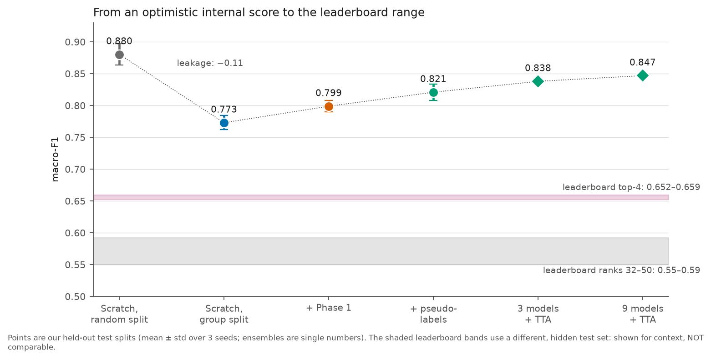
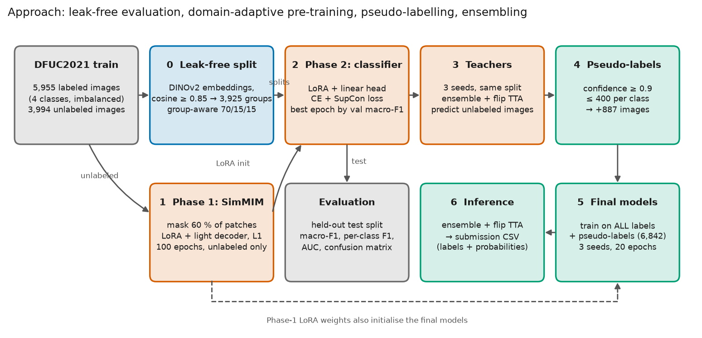

# Domain-Adaptive Foundation Models for Fine-Grained DFU Classification

Diabetic Foot Ulcer (DFU) classification on **DFUC2021** with a frozen **DINOv2 ViT-B/14**
backbone, **LoRA** adapters (0.68 % of the parameters), **supervised contrastive learning**,
self-supervised **domain adaptation** on unlabeled images, **pseudo-labelling**, and a
**leak-free evaluation protocol**.

- **Task:** 4 classes — `none` (leaderboard name: *Control*), `infection`, `ischaemia`, `both`.
- **Data:** 5,955 labeled + 3,994 unlabeled training images, 5,734 hidden-label test images.
  Strong imbalance (ischaemia ≈ 4 % of the labels).
- **Leaderboard metric:** macro-F1 (ties: macro recall / UAR, then macro-AUC) — see [docs/LEADERBOARD.md](docs/LEADERBOARD.md).
- **Leaderboard result:** **macro-F1 0.588, rank 39** (first submission, 17 Oct 2026; top entry 0.659).



## Findings in one page

All numbers are on held-out test splits of the public training data (mean ± std over 3 seeds)
unless stated. Full details, figures and caveats: [docs/EXPERIMENTS.md](docs/EXPERIMENTS.md).

| # | Question | Finding |
|---|---|---|
| 1 | Is the usual random split trustworthy? | **No.** 22 % of random-split test images have a near-duplicate (cosine ≥ 0.90) in the training split. Re-evaluating with a group-aware split lowers the same scratch model from **0.880 to 0.773** macro-F1. |
| 2 | Does domain-adaptive pre-training (Phase 1) help? | **Modestly.** On the leak-free split Phase 1 beats scratch in 3/3 seeds (**0.799 vs 0.773**, +0.026; ischaemia and "both" F1 +0.06/+0.05). On the random split it looked useless (0.870 vs 0.880): leakage hid the effect. Caveat: on the last-epoch model the gain is only +0.004. |
| 3 | Do the unlabeled images help as pseudo-labels? | **A little.** Phase 1 + pseudo-labels: **0.821** (+0.022 over Phase 1 alone, 3/3 seeds). Few rare-class pseudo-labels pass the confidence filter, so the gain probably comes mostly from extra common-class data. |
| 4 | Do strong augmentation + label smoothing help? | **No.** Macro-AUC drops (0.936 → 0.905) and ischaemia F1 drops (0.712 → 0.655) for scratch models. |
| 5 | Do ensembles / flip-TTA help? | **Yes — the most reliable gain.** 3-model ensembles add ≈ +0.03 macro-F1, flip-TTA another +0.01–0.02. Best: **0.838** (3 models) and **0.847** (9 models) with TTA. |
| 6 | How do the models behave on the real challenge test images? | They **over-call ischaemia and miss infections.** The models predict 9.5 % ischaemia and 34 % infection, but the leaderboard result implies the test set has the training mix (≈ 4 % and 44 %). The class mix did not shift; the decision boundaries did. |
| 7 | What does the leaderboard say? | **Macro-F1 0.588, rank 39** on the open DFUC2021 testing leaderboard (top: 0.659). Ranking quality is near the top (macro-AUC 0.870 = 4th place); the hard decisions are the weak point. See below. |

> **What is *not* shown.** No low-label study; internal results come from one fixed split (seeds
> vary initialisation only); ischaemia has only 29 internal test images, so per-class results are
> noisy. Internal scores (0.77–0.85) were measured on held-out *training* images and turned out to
> be ≈ 0.26 higher than the leaderboard score (0.588) on the organisers' test set.

## First leaderboard submission (17 Oct 2026)

Submitted `artifacts/sub_final_probs.csv` (3 final models: Phase 1 + pseudo-labels, all labels,
flip TTA) to the DFUC2021 **live testing leaderboard (open)**, which scores the 5,734 challenge test
images against the organisers' hidden labels. Raw metrics: [`results/leaderboard_submission1.json`](results/leaderboard_submission1.json).

**Overall: macro-F1 0.5878 → rank 39.** Expected range from the internal results was 0.55–0.62.

| Metric | This project | #1 | #4 | #32 | Reading |
|---|---|---|---|---|---|
| **Macro-F1** (ranking) | **0.588** | 0.659 | 0.652 | 0.592 | 0.07 behind the top |
| Macro recall (UAR, 1st tie-break) | **0.660** | 0.659 | 0.686 | 0.580 | higher than #1 and #2 |
| Macro AUC (2nd tie-break) | **0.870** | 0.895 | 0.870 | 0.869 | equal to 4th place |
| Micro AUC | 0.890 | 0.917 | 0.899 | 0.897 | |
| Accuracy / micro-F1 | 0.671 | 0.717 | 0.693 | 0.661 | above #32 |
| Macro precision | 0.571 | 0.665 | 0.652 | 0.618 | weakest aggregate |

**Per class**

| Class | F1 | Precision | Recall | AUC | Top-4 F1 range | Verdict |
|---|---|---|---|---|---|---|
| Control (`none`) | **0.744** | 0.708 | 0.783 | 0.836 | 0.746–0.771 | ✅ best category — within 0.03 of the top 4 |
| Infection | **0.658** | 0.752 | 0.584 | 0.803 | 0.642–0.715 | ✅ inside the top-4 range (beats #3 and #4) |
| Ischaemia | 0.473 | 0.334 | **0.809** | **0.952** | 0.584–0.628 | ⚠️ finds most cases (highest recall and AUC of all classes) but 2 of 3 ischaemia calls are wrong |
| Both | 0.477 | 0.490 | 0.464 | 0.890 | 0.563–0.592 | ⚠️ weakest class |

**What it means**

- **Strengths:** Control F1 is within 0.03 of the top 4 and Infection F1 is inside the top-4 range; UAR is above #1; macro-AUC equals 4th
  place. The model *ranks* images about as well as the leading entries.
- **Weakness — decision boundaries, not features:** ischaemia AUC is 0.95 but F1 is 0.47. Implied
  test-set class counts (predicted count × precision / recall) are ≈ 2,517 / 2,516 / 225 / 476 —
  the same mix as training — while the model predicted 2,784 / 1,954 / **545** / 451. It
  over-calls ischaemia (×2.4) and misses ≈ 560 infections.
- **Internal vs leaderboard:** the leak-free split removed ≈ 0.1 of optimism (0.88 → 0.77–0.85),
  but the organisers' test images are harder still (0.588). Group-aware evaluation is necessary,
  not sufficient.

**Next step — done properly.** Changing the decision rule *because* of this score and resubmitting
would tune on the leaderboard. Instead, a protocol fixed in advance
([docs/CALIBRATION_PROTOCOL.md](docs/CALIBRATION_PROTOCOL.md)) compares plain arg-max, label-free
prior matching and validation-tuned class biases on the **leak-free internal split**, and a
pre-registered decision rule picks the method (or none) before the leaderboard is used again:

```bash
RULE=noninferiority ./scripts/run_calibration.sh   # → results/calib/challenge_<method>_probs.csv
```

At most one further submission. (`artifacts/sub_priormatch_probs.csv` is the direct prior-matching
output prepared earlier; it is superseded by the protocol and should not be submitted on its own.)

## Approach



1. **Leak-free split** — cluster near-duplicate images (frozen DINOv2 embeddings) and keep each
   cluster in one split ([`src/make_groups.py`](src/make_groups.py)).
2. **Phase 1** — SimMIM masked-image modelling: mask 60 % of patches, reconstruct pixels, train
   only LoRA adapters + a light decoder on the 3,994 unlabeled images ([`src/pretrain.py`](src/pretrain.py)).
3. **Phase 2** — cross-entropy + supervised-contrastive loss on the [CLS] embedding; only LoRA +
   a linear head are trained ([`src/train.py`](src/train.py)).
4. **Pseudo-labelling** — teachers label the unlabeled images; confident ones join training.
5. **Final models + inference** — train on all labels (+ pseudo-labels), then ensemble with
   flip test-time augmentation ([`src/predict.py`](src/predict.py)).

Method details, hyper-parameters and metric definitions: [docs/METHODS.md](docs/METHODS.md).

**How it differs from the usual DFUC2021 recipe** (supervised CNN ensembles on the labeled
images, as far as I know): a *foundation model* adapted with very few trainable parameters
(≈ 5 min per model on an L40S, so ensembles and pseudo-label rounds are cheap); *self-supervised
adaptation* and *pseudo-labelling* of the unlabeled images; a *leak-free evaluation protocol*;
and metrics reported exactly like the leaderboard.

## Quick start

```bash
# 1. Environment (PyTorch build must match your CUDA driver)
python -m venv .venv && source .venv/bin/activate
pip install torch torchvision --index-url https://download.pytorch.org/whl/cu118
pip install -r requirements.txt

# 2. Data (not tracked): Data/DFUC2021_train/{images/*.jpg, train.csv}

# 3. Smoke test (20 images, seconds)
python -m src.pretrain --debug && python -m src.train --debug

# 4. Everything in one go (~45 min on one L40S): groups, ablations, pseudo-labels, ensembles
nohup bash scripts/run_all_experiments.sh > logs/all.log 2>&1 &
```

Step-by-step commands for each experiment are in [docs/EXPERIMENTS.md](docs/EXPERIMENTS.md);
cluster / Slurm / VS Code instructions in [docs/CLUSTER.md](docs/CLUSTER.md).

| Goal | Command |
|---|---|
| Phase 1 pre-training | `python -m src.pretrain [--epochs N --extra_img_dirs DIR ...]` |
| Near-duplicate groups | `python -m src.make_groups --auto` → `groups.csv` |
| Phase 2 + held-out evaluation | `python -m src.train --group_csv groups.csv [--pretrained_lora_path ...]` |
| Pseudo-labels (teacher step) | `python -m src.predict --checkpoints ... --unlabeled_train --tta --out pseudo.csv` |
| Final models on all labels | `python -m src.train --final --epochs 20 --pseudo_csv pseudo_probs.csv ...` |
| Ensemble + TTA / submission CSV | `python -m src.predict --checkpoints ... (--split test \| --img_dir DIR) --tta` |
| Validate + apply decision-rule calibration | `RULE=noninferiority ./scripts/run_calibration.sh` (→ `src.calibrate`) |
| Re-balance a submission to the training class mix (no validation) | `python scripts/prior_match.py artifacts/sub_final_probs.csv --out sub_priormatch_probs.csv` |
| Compare runs | `python -m src.summarize` |
| Rebuild figures and tables | `python scripts/make_figures.py` |

## Repository layout

```
src/            dataset, common, metrics, model, pretrain(+_model), train, predict, calibrate, make_groups, summarize
scripts/        run_all_experiments.sh (one-shot suite), run_pseudo.sh, run_lowlabel.sh, *.sbatch, make_figures.py, prior_match.py, run_calibration.sh
docs/           METHODS.md, EXPERIMENTS.md, LEADERBOARD.md, CALIBRATION_PROTOCOL.md, CLUSTER.md, results_tables.md, figures/
results/        one JSON per run (metrics, confusion matrix, per-epoch history), summary.csv, ensemble_round2.csv
logs/           raw training / evaluation logs (see logs/README.md)
artifacts/      groups.csv, pseudo-label CSVs, challenge-test prediction CSVs (see artifacts/README.md)
Notebooks/      01_data_explore.ipynb (EDA)
CHANGELOG.md    full history from the initial state
```

## Documentation

- [docs/METHODS.md](docs/METHODS.md) — what each component is and why, protocol, metrics, hyper-parameters
- [docs/EXPERIMENTS.md](docs/EXPERIMENTS.md) — every experiment: motivation, setup, results, figures, interpretation, limitations
- [docs/LEADERBOARD.md](docs/LEADERBOARD.md) — leaderboard context, first submission result and diagnosis, submission workflow
- [docs/CALIBRATION_PROTOCOL.md](docs/CALIBRATION_PROTOCOL.md) — pre-registered protocol for the second submission
- [docs/results_tables.md](docs/results_tables.md) — all tables (generated)
- [docs/CLUSTER.md](docs/CLUSTER.md) — running on an HPC cluster, troubleshooting
- [CHANGELOG.md](CHANGELOG.md) — what changed and why

## License

For academic and research purposes.
