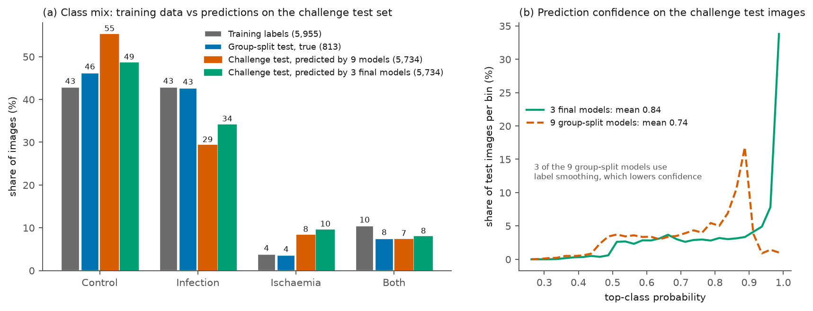

# DFUC2021 leaderboard: metrics, position, expectations

The DFUC2021 *open* (testing-set) leaderboard ranks submissions by **macro-F1** over the four
classes. This page records the reference scores, where this project stands, and what can honestly
be expected. **First submission: 17 Oct 2026 — macro-F1 0.588, rank 39** (§3a); §5 keeps the
pre-submission expectations for comparison.

## 1. Reference scores (live leaderboard snapshot)

| Rank / user | Macro-F1 | Control | Infection | Ischaemia | Both | Macro prec. | Macro recall | Macro AUC | Micro F1 | Micro AUC |
|---|---|---|---|---|---|---|---|---|---|---|
| 1 Mahamudul_Hasan | **0.6592** | 0.7594 | 0.7145 | 0.5996 | 0.5634 | 0.6652 | 0.6593 | 0.8945 | 0.7172 | 0.9165 |
| 2 mdzh10 (Team_Sagittarius) | 0.6537 | 0.7570 | 0.6898 | 0.5843 | 0.5836 | 0.6697 | 0.6433 | 0.8902 | 0.7063 | 0.9111 |
| 3 iftekhar.ahmed (Team_Sagittarius) | 0.6534 | 0.7456 | 0.6484 | 0.6278 | 0.5919 | 0.6488 | 0.6874 | 0.8910 | 0.6855 | 0.9075 |
| 4 ffyytt (DFU-MORIS) | 0.6517 | 0.7709 | 0.6424 | 0.6118 | 0.5817 | 0.6520 | 0.6863 | 0.8698 | 0.6926 | 0.8989 |
| 32 sayefshahriar | 0.5923 | 0.6816 | 0.6865 | 0.5067 | 0.4945 | 0.6175 | 0.5795 | 0.8686 | 0.6613 | 0.8967 |
| 39 mohid | 0.5817 | 0.7371 | 0.6031 | 0.5088 | 0.4778 | 0.5821 | 0.6086 | 0.8257 | 0.6478 | 0.8483 |
| 49 d4mz | 0.5507 | 0.7324 | 0.6011 | 0.4397 | 0.4294 | 0.5579 | 0.5983 | 0.8596 | 0.6382 | 0.8783 |
| **39 this project** (submission 1) | **0.5878** | 0.7440 | 0.6577 | 0.4727 | 0.4768 | 0.5712 | 0.6602 | 0.8702 | 0.6706 | 0.8897 |

Top-4 ranges: macro-F1 **0.652–0.659** (spread 0.008), Control F1 0.746–0.771, Infection 0.642–0.715,
Ischaemia 0.584–0.628, Both 0.563–0.592, macro AUC 0.870–0.895. Ranks ≈ 32–50: macro-F1 0.55–0.59.

## 2. What the numbers say

- **Hard task:** even the best entries reach ≈ 0.66 macro-F1 and ≈ 0.72 micro-F1.
- **Rare classes decide the ranking:** Control F1 is similar everywhere (0.73–0.77); ischaemia and
  "both" (0.43–0.63) are where entries differ.
- **AUC ≫ F1:** macro AUC ≈ 0.87–0.89 vs macro-F1 ≈ 0.65 — ranking quality is decent but the hard
  decisions are off, consistent with a class-mix / calibration shift between training and test.

## 3. Where this project stands

Internal, leak-free (group-aware) results — **a different, non-hidden test set, so not comparable**:

| Setup | Macro-F1 | Macro AUC | F1: Ctrl / Inf / Isch / Both |
|---|---|---|---|
| Scratch (single model, mean of 3) | 0.773 | 0.936 | 0.807 / 0.774 / 0.712 / 0.798 |
| Phase 1 | 0.799 | 0.934 | 0.794 / 0.779 / 0.771 / 0.851 |
| Phase 1 + pseudo-labels | 0.821 | 0.933 | 0.825 / 0.786 / 0.777 / 0.895 |
| 3-model ensemble + TTA (Phase 1 + pseudo) | 0.838 | 0.945 | — |
| 9-model ensemble + TTA | 0.847 | 0.937 | — |

The gap between these (0.77–0.85) and the leaderboard (0.55–0.66) is mostly **distribution shift** to the
hidden test set: the random-split → group-split drop explains ≈ 0.1, the rest cannot be measured on
training data. The shift is visible in the predictions on the real test images:

On held-out training data the models predict ≈ 3 % ischaemia and ≈ 41 % infection; on the 5,734
challenge images they predict 8–10 % and 29–34 %. Before submitting we read this as a different class
mix; **the first leaderboard result (§3a) shows it is not** — the test set has ≈ 4 % ischaemia and
≈ 44 % infection, like training — so the images look different enough to move the decisions. Two
prediction sets from different model groups agree on 86.6 % of images.

## 3a. First submission — result and diagnosis

**File:** `artifacts/sub_final_probs.csv` (3 final models, Phase 1 + 887 pseudo-labels, all 5,955
labels, flip TTA; probabilities as required by the evaluation page). **Score:** macro-F1 0.5878,
rank 39. Raw metrics: [`results/leaderboard_submission1.json`](../results/leaderboard_submission1.json).

| Class | F1 | Precision | Recall | AUC | Predicted | Implied true count* |
|---|---|---|---|---|---|---|
| Control | 0.744 | 0.708 | 0.783 | 0.836 | 2,784 | ≈ 2,517 (43.9 %) |
| Infection | 0.658 | 0.752 | 0.584 | 0.803 | 1,954 | ≈ 2,516 (43.9 %) |
| Ischaemia | 0.473 | 0.334 | 0.809 | 0.952 | 545 | ≈ 225 (3.9 %) |
| Both | 0.477 | 0.490 | 0.464 | 0.890 | 451 | ≈ 476 (8.3 %) |
| Training labels (for reference) | | | | | | 42.9 / 42.9 / 3.8 / 10.4 % |

\*true count = predicted count × precision / recall; the four counts sum to 5,734 and reproduce
the reported accuracy (0.6706), so the derivation is exact up to rounding.

**Reading.**
1. **Strong categories:** Control F1 within 0.03 of the top 4; Infection F1 (0.658) inside the
   top-4 range and above #3 and #4. Macro recall (UAR, the first tie-breaker) 0.660 is above #1
   and #2; macro AUC 0.870 equals #4.
2. **Weak categories:** ischaemia and "both" F1 (≈ 0.47) are 0.11–0.15 below the top 4. For
   ischaemia this is a *threshold* problem, not a feature problem: AUC 0.952 and recall 0.81, but
   precision 0.33 because the model calls 545 images ischaemia when only ≈ 225 are.
3. **The class-mix hypothesis of E7 was wrong.** The test set has the training mix (≈ 44 / 44 / 4 /
   8 %). The shift is in appearance: the same decision boundaries put too many images into
   ischaemia and too few into infection on the challenge images.
4. **Internal vs leaderboard gap:** 0.838 (3-model ensemble + TTA, leak-free split) vs 0.588.
   Removing near-duplicate leakage was necessary but did not make internal scores predictive of
   the hidden test set.

**Next candidate:** `scripts/prior_match.py` fits one additive log-bias per class so that arg-max
predictions on the unlabeled test images reproduce the training label proportions (42.9 / 42.9 /
3.8 / 10.4 %), using no test labels → `artifacts/sub_priormatch_probs.csv`. Biases: none +0.50,
infection +1.19, ischaemia −2.10, both +0.42. 765 predictions change:

| from → to | count |
|---|---|
| ischaemia → both | 199 |
| ischaemia → infection | 69 |
| ischaemia → none | 58 |
| none → infection | 386 |
| both → infection | 52 |
| both → none | 1 |

These moves follow the internal confusion pattern (ischaemia ↔ both, Control ↔ infection).
Because the idea came from reading the first leaderboard result, it is documented as
post-hoc; the target proportions themselves come only from `train.csv`. Plan: one submission
of this file, no further tuning on the leaderboard. A label-based variant (per-class thresholds
tuned on the validation split) is the cleaner version for a write-up.

## 4. How the approach differs and why it may help

| Aspect | Typical supervised entry (as far as I know) | This project |
|---|---|---|
| Backbone | ImageNet CNN/ViT fully fine-tuned, often an ensemble | Frozen DINOv2 ViT-B/14 + LoRA (0.68 % trainable); ensemble of ≈ 5-minute models |
| Unlabeled data (3,994) | often unused, or pseudo-labelling | SimMIM domain adaptation **and** pseudo-labelling |
| Loss | cross-entropy (+ weights / focal) | CE + supervised contrastive on [CLS] + class weights |
| Validation | random hold-out / k-fold | group-aware split against near-duplicate leakage |
| Inference | TTA + ensemble | flip TTA + ensemble |

Measured contribution of each part (leak-free split): Phase 1 **+0.026**, pseudo-labels **+0.022**,
ensembling **+0.03**, TTA **+0.01–0.02**; strong augmentation + label smoothing **−** (AUC −0.03).
These are modest, individually near the seed noise (±0.01), but consistent across seeds.

## 5. Honest expectations

These were planning estimates made *before* the first submission (kept for comparison; the
measured result, 0.588, fell inside the predicted 0.55–0.62 range):

- **Leaderboard, this recipe:** the internal gains are a few points each; whether they transfer under
  shift is unknown. A mid-table score (≈ 0.55–0.62 macro-F1) is plausible; the top-4 are separated by
  < 0.01, so reaching ≥ 0.65 would need a further ≈ +0.05 beyond the internal gains and is a stretch goal.
- **What would raise confidence:** the leaderboard row of the first submission — it shows whether the
  gap is mostly shift (all classes low), class mix (ischaemia/infection F1 off) or calibration (AUC
  fine, F1 low).
- **Watch these columns:** macro-F1 ≥ 0.65, ischaemia F1 ≥ 0.58, both F1 ≥ 0.56, macro AUC ≥ 0.89.

## 6. Submission workflow

1. Settings were chosen on the **group-aware** split (E4 in [EXPERIMENTS.md](EXPERIMENTS.md)).
2. Final models: `python -m src.train --final ...` on all labeled images + pseudo-labels (3 seeds).
3. Predict the challenge images with ensemble + TTA:
   `python -m src.predict --checkpoints checkpoints/final_pre_pseudo_s*_final.pt --img_dir <test_images> --tta --out sub_final.csv`
   → `sub_final.csv` (one-hot labels) and `sub_final_probs.csv` (probabilities). Candidate files are in
   [`artifacts/`](../artifacts/README.md).
4. **Submission format (confirmed on the evaluation page):** one row per test image with the
   *probability* of each class — `image,none,infection,ischaemia,both`. Submit the `*_probs.csv`
   file, not the one-hot file (AUC from hard labels is much lower).
5. Log the score next to the group-split score (done for submission 1, §3a).
6. Ranking: macro-F1; ties are broken by macro recall (UAR), then macro-AUC, then submission time.

## 7. Rules and risks

- Check the rules on pre-trained weights (DINOv2), pseudo-labelling, and any use of unlabeled test
  images (e.g. class-prior adjustment or Phase-1 adaptation on them) before relying on them.
- Do not tune on the leaderboard; use it as a sparse check of shift.
- DFUC2020 (as far as I recall, ulcer bounding boxes for detection) cannot train the 4-class head; at
  most it can add unlabeled images to Phase 1 (`--extra_img_dirs`). DFUC2022 (segmentation, Dice) is a
  different task and would need masks and a segmentation head.
